  

    

  

    &nbsp;
    &nbsp;
    &nbsp;
    &nbsp;
    
  

   

  

---

## 👋 About Me

I'm **Masud Rana Nayeem**, a Computer Science and Engineering student at **Daffodil International University**. I enjoy building modern web experiences, learning new technologies, and exploring how software can solve real-world problems.

- ⚛️ Interested in React, TypeScript, and modern frontend engineering
- 🎨 Focused on clean interfaces, responsive layouts, and user experience
- 🔧 Exploring backend development, APIs, and database integration
- 🧠 Learning about deep learning and computer vision
- 🌱 Always improving through experimentation and hands-on development

---

## 🧰 Technology Matrix

  <strong>Frontend Engineering</strong>
    
  

  <strong>Backend & Database</strong>
    
  

  <strong>AI / ML & Core Languages</strong>
    
  

  <strong>Tools & Platforms</strong>
    
  

---

## 📊 GitHub Overview

  
  

    

  

---

## 📈 Contribution Activity

  

---

## 🐍 Contribution Snake

  <picture>
    <source media="(prefers-color-scheme: dark)" srcset="https://raw.githubusercontent.com/masudrananayeem/masudrananayeem/output/github-contribution-grid-snake-dark.svg" />
    <source media="(prefers-color-scheme: light)" srcset="https://raw.githubusercontent.com/masudrananayeem/masudrananayeem/output/github-contribution-grid-snake.svg" />
    
  </picture>

---

## 🧠 How I Work

<table>
  <tr>
    <td align="center" width="33%">
      <h3>✨ Explore</h3>
      Stay curious, experiment with ideas, and learn beyond the familiar.
    </td>
    <td align="center" width="33%">
      <h3>⚡ Build</h3>
      Turn ideas into practical, accessible digital experiences.
    </td>
    <td align="center" width="33%">
      <h3>♻️ Improve</h3>
      Refine the details, write better code, and keep growing.
    </td>
  </tr>
</table>

---

  <h3>Thanks for visiting my profile!</h3>

  
<i>Turning ideas into digital experiences — one line of code at a time.</i>

  

    

  

