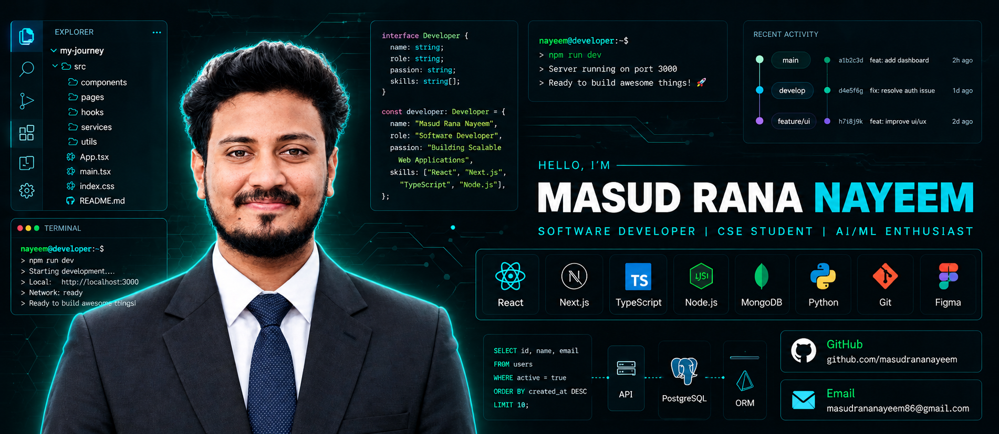

01 — SYSTEM PROFILE
Computer Science Student · Software Developer · Problem Solver

I'm Masud Rana Nayeem, a Computer Science and Engineering student at Daffodil International University, Bangladesh. I enjoy building modern web experiences, creating useful digital products, and exploring intelligent software systems through AI/ML and deep learning.
- ⚛️ Interested in React, TypeScript, and modern frontend engineering
- 🎨 Focused on clean interfaces, responsive layouts, and thoughtful user experience
- 🔧 Exploring backend development, APIs, and database integration
- 🧠 Researching deep learning and computer vision for agricultural applications
- 🌱 Always improving through experimentation and hands-on development
name: Masud Rana Nayeem
role: Software Developer
education: B.Sc. in Computer Science & Engineering
university: Daffodil International University
location: Bangladesh
interests:
  - Modern Web Development
  - Frontend Engineering & UI/UX
  - Backend Systems & API Design
  - Artificial Intelligence & Deep Learning
mindset: Learn -> Build -> Improve

02 — TECHNOLOGY MATRIX
Tools I use and technologies I explore.

<table>
<tr>
<td width="50%" valign="top">

◈ PROGRAMMING LANGUAGES

◈ FRONTEND ENGINEERING

</td>
<td width="50%" valign="top">

◈ BACKEND & DATA

◈ DEVELOPMENT TOOLKIT

</td>
</tr>
</table>

03 — SELECTED PROJECTS
Ideas, engineering, and real-world problem solving.

<table>
<tr>
<td width="50%" valign="top">

🌏 BDpedia
Explore the beauty of Bangladesh.

An information and travel platform for discovering Bangladesh's districts, destinations, history, culture, and travel resources.
- District and destination discovery
- History, culture, rivers, and galleries
- Travel guides and destination information
- Configurable content management
React TypeScript Tailwind CSS
</td>
<td width="50%" valign="top">

🩸 BloodBridge
Connecting blood donors with those in need.

A blood donation platform concept focused on accessible donor discovery and privacy-conscious contact access.
- Blood group and location-based search
- Emergency donor discovery
- Privacy-conscious contact access
- 120-day donation cooldown concept
Web Development APIs Database Design
</td>
</tr>
<tr>
<td width="50%" valign="top">

💻 Developer Portfolio
A modern portfolio concept showcasing technical skills, education, research, and professional information.
- Responsive interface and animations
- Profile and content presentation
- Admin-managed content
- GitHub activity integration
React TypeScript Firebase Cloudflare
</td>
<td width="50%" valign="top">

🍆 Eggplant Disease Detection
An ensemble-based hybrid multi-model deep learning research project for classifying eggplant diseases and related leaf conditions.
- Image dataset preparation
- Five-category classification
- Leakage-aware dataset validation
- Model training and evaluation
Python PyTorch Torchvision Computer Vision
</td>
</tr>
</table>

04 — GITHUB TELEMETRY
An overview of my public development activity.

05 — CONTRIBUTION FLOW
<picture>
  <source media="(prefers-color-scheme: dark)" srcset="https://raw.githubusercontent.com/masudrananayeem/masudrananayeem/output/github-contribution-grid-snake-dark.svg" />
  <source media="(prefers-color-scheme: light)" srcset="https://raw.githubusercontent.com/masudrananayeem/masudrananayeem/output/github-contribution-grid-snake.svg" />
  
</picture>

06 — PROBLEM SOLVING

07 — NEXT OBJECTIVES
<table>
<tr>
<td align="center" width="25%">

01
⚛️
Frontend
</td>
<td align="center" width="25%">

02
⚙️
Backend
</td>
<td align="center" width="25%">

03
🧠
AI / ML
</td>
<td align="center" width="25%">

04
🌐
Open Source
</td>
</tr>
</table>

HAVE AN INTERESTING IDEA?
Let's connect, exchange ideas, and build something meaningful.

DESIGNED WITH PURPOSE · BUILT WITH CURIOSITY · POWERED BY CODE

